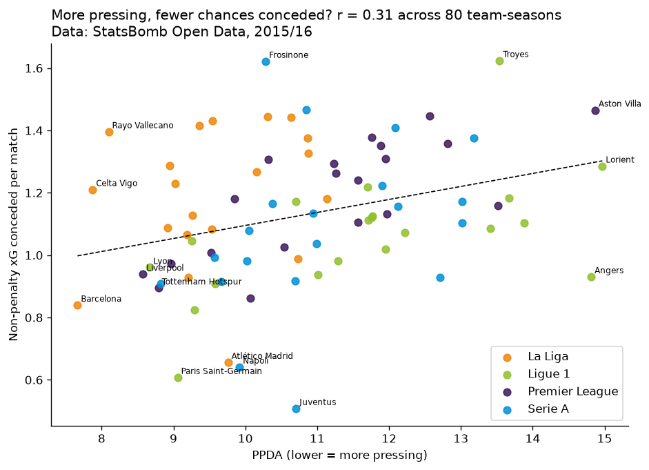
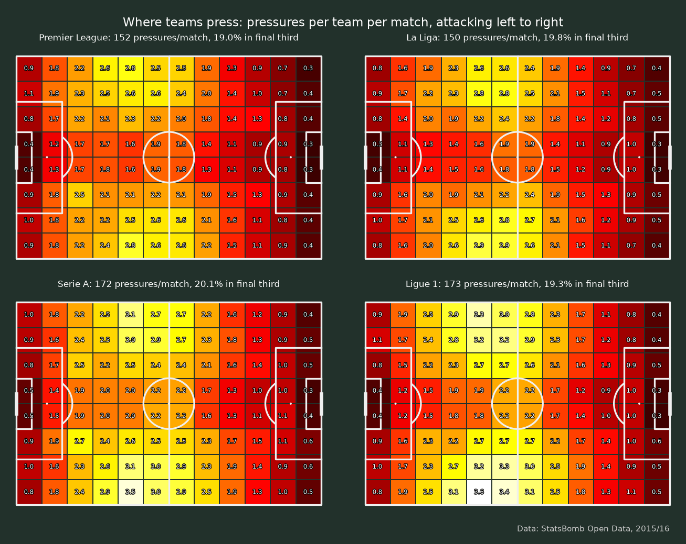
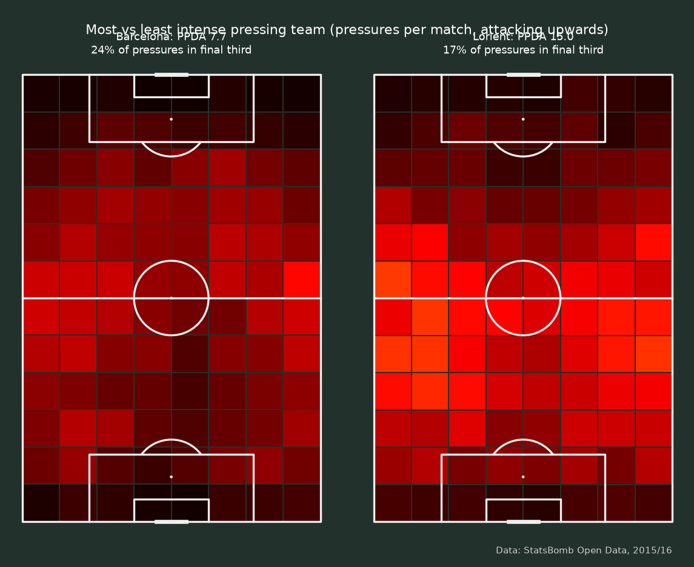
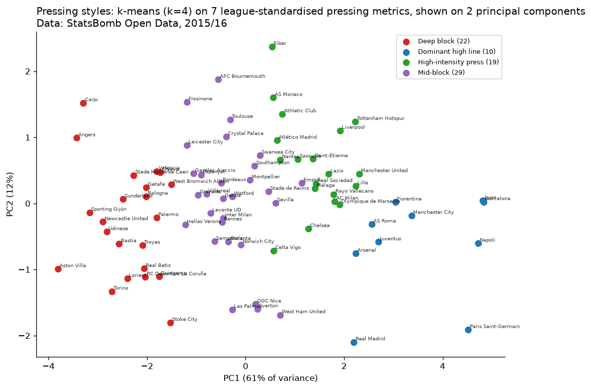
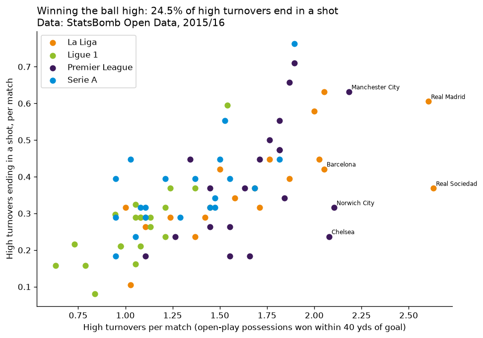
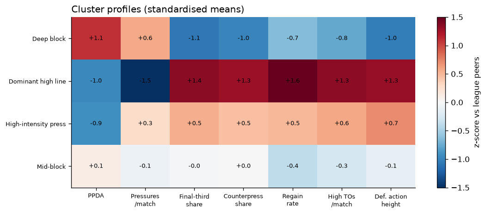
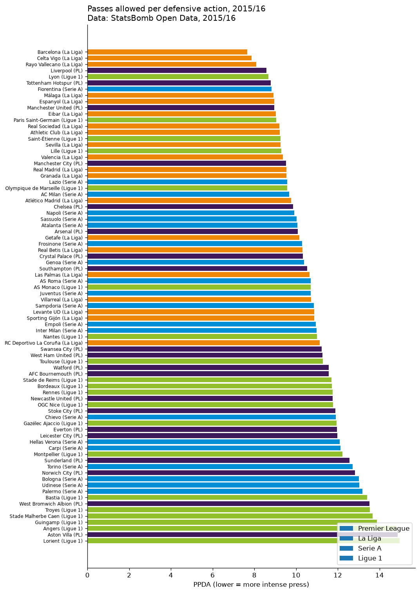

# Pressing intensity in Europe's top leagues: PPDA, pressure maps and pressing styles (2015/16)

How hard, and where, do teams press, and does it pay off? This project turns **StatsBomb Open Data** event
data for **1,517 matches** of the 2015/16 Premier League, La Liga, Serie A and Ligue 1 into pressing metrics for
all 80 clubs: **PPDA** (passes allowed per defensive action), pressures by pitch zone, counterpressing, pressure
regains and **high turnovers**. It then tests how pressing relates to chances conceded, groups the teams into
pressing styles with **k-means**, and puts everything in a Streamlit explorer with mplsoccer pitch maps.

Author: Anthony Adusei-Poku ([@anthony07-max](https://github.com/anthony07-max))



## Key findings (2015/16, 80 team-seasons)

| League | PPDA (lower = more pressing) | Pressures per team per match | Share of pressures in final third |
|---|---|---|---|
| La Liga | **9.53** | 150 | 19.8% |
| Serie A | 11.00 | 172 | 20.1% |
| Premier League | 11.06 | 152 | 19.0% |
| Ligue 1 | 11.60 | 173 | 19.3% |

1. **Barcelona pressed hardest of all 80 teams (PPDA 7.66)**, ahead of Celta Vigo (7.87), Rayo Vallecano (8.10),
   Liverpool (8.57) and Lyon (8.67). The most passive teams were Lorient (14.97),
   relegated Aston Villa (14.87) and Angers (14.81).
2. **La Liga was the most intense pressing league by PPDA (9.53, against 11.0 to 11.6 elsewhere).** But Serie A
   and Ligue 1 teams made **about 20 more pressures per match** (172 to 173 against 150 to 152). They pressed more
   often, but less of it led to tackles, interceptions or fouls high up the pitch. In every league, only 19 to 20% of
   pressures happened in the final third.
3. **Teams that press more concede fewer chances.** Across the 80 team-seasons, PPDA correlates with non-penalty
   xG conceded per match at **r = 0.32** (p = 0.004). The link is stronger within leagues (**r = 0.48**).
   The quarter of teams that pressed hardest conceded **1.04 npxG per match**, against **1.22** for the quarter
   that pressed least. Even within a team, in matches where it pressed harder than its season average it tended to
   concede less (r = 0.23 between the two deviations).
4. **Winning the ball high creates shots.** There were **4,350 high turnovers** (open-play possessions started
   within 40 yards of goal), and **24.5%** of them ended in a shot. Real Sociedad (2.63 per match), Real Madrid (2.61)
   and Manchester City (2.18) won the most. Teams with a lower PPDA had more high turnovers (r = -0.52).
5. **Four pressing styles** (k-means on 7 metrics, standardised within each league):
   | Style | Teams | PPDA | Pressures / match | Final-third share | Regain rate | npxG conceded / match | Examples |
   |---|---|---|---|---|---|---|---|
   | Dominant high line | 10 | 9.5 | 146 | 22.8% | 14.9% | **0.83** | Barcelona, Lyon, Fiorentina, PSG, Man City, Real Madrid |
   | High-intensity press | 19 | 9.3 | 163 | 20.8% | 13.7% | 1.02 | Celta Vigo, Rayo, Liverpool, Tottenham, Man United |
   | Mid-block | 29 | 11.1 | 161 | 19.5% | 12.5% | 1.22 | Espanyol, Sevilla, Atalanta, Crystal Palace, Leicester |
   | Deep block | 22 | 12.6 | 170 | 17.3% | 12.2% | 1.26 | Valencia, Getafe, Newcastle, Aston Villa, Torino |

   The dominant sides make the *fewest* pressures because they have the ball most of the time. When they do press,
   they do it high and win the ball back quickly. Deep blocks make the *most* pressures, but in their own half.

| | |
|---|---|
|  |  |
|  |  |




## Method
All coordinates are on StatsBomb's 120 x 80 pitch, from the acting team's point of view.
- **PPDA** = opponent open-play passes in the opponent's own 60% of the pitch (passer x <= 72) / the pressing
  team's defensive actions in its attacking 60% (x >= 48). Defensive actions are tackles, interceptions, fouls
  committed and challenges (StatsBomb `Dribbled Past`). Set-piece passes (free kicks, corners, throw-ins, goal kicks,
  kick-offs) are excluded.
- **Pressures by zone**: StatsBomb `Pressure` events counted on a 12 x 8 grid of 10-yard cells, and in thirds
  (defensive x < 40, middle, final x >= 80). The counterpress share uses StatsBomb's `counterpress` flag.
- **Pressure regain**: a pressure followed by the pressing team starting a possession within 5 seconds, in the same half.
- **High turnover**: a possession that starts in open play (`Regular Play` or `From Counter`) and whose first event
  is at x >= 80, i.e. within 40 yards of the opponent's goal. It "ends in a shot" if the same possession contains a shot.
- **Chances conceded**: StatsBomb non-penalty xG of the opponent's shots.
- **Clustering**: 7 team-season features (PPDA, pressures per match, final-third share, counterpress share, regain
  rate, high turnovers per match, mean height of defensive actions) are z-scored *within each league*, then grouped by
  k-means (k = 4, 50 initialisations). The groups are named by rule from their centroids. PCA is used only for the chart.

## Data source and licence
- [StatsBomb Open Data](https://github.com/statsbomb/open-data): event data for the 2015/16 Premier League
  (competition 2), La Liga (11), Serie A (12) and Ligue 1 (7), all season 27. **Data provided by StatsBomb.**
  It is used under the [StatsBomb Public Data User Agreement](https://github.com/statsbomb/open-data/blob/master/LICENSE.pdf)
  for non-commercial research and education, and StatsBomb is credited as the data source on every chart.
- The 2015/16 Bundesliga is left out because only 34 of its matches are released. Ligue 1 has 377 of 380 matches.

## Project structure
```
src/download.py      # fetches StatsBomb events for 4 leagues and keeps a compact parquet per league (data/raw/)
src/clean.py         # per team-match and team-season pressing metrics and the pressure grid (data/processed/)
src/analysis.py      # findings, correlations, k-means, mplsoccer charts, key_findings.json
app/streamlit_app.py # interactive explorer (league table, team pressure map, scatter plots, styles)
charts/              # PNG outputs
data/processed/      # tidy CSVs used by the app
```

## How to run
```bash
python -m venv .venv && source .venv/bin/activate
pip install -r requirements.txt
./run_pipeline.sh                      # download (~1,500 match files, a few minutes), clean, analyse
streamlit run app/streamlit_app.py     # explorer at http://localhost:8501
```

## Limitations
- **This is a single season (2015/16)** from a free dataset. Squads and managers have changed a lot since then.
- **Correlation is not causation.** Better teams both press more and concede less, and game state also matters,
  because teams that are leading sit deeper. The within-team match-level check reduces this problem, but it does
  not remove it.
- Event data only records the presser closest to the ball, so it cannot show the team's shape or how coordinated the press was.
  StatsBomb 360 freeze-frames are not available for these seasons.
- Raw pressure counts differ between leagues (Serie A and Ligue 1 are about 14% higher). This may be partly tactical and
  partly down to how the data was collected, so clustering uses within-league z-scores.
- The clusters overlap (silhouette 0.21 for k = 4, and 0.33 for k = 2). Treat them as broad descriptions of style,
  not hard categories.
- PPDA definitions vary between providers. These numbers are internally consistent, but they are not directly comparable with
  published PPDA from other sources.
